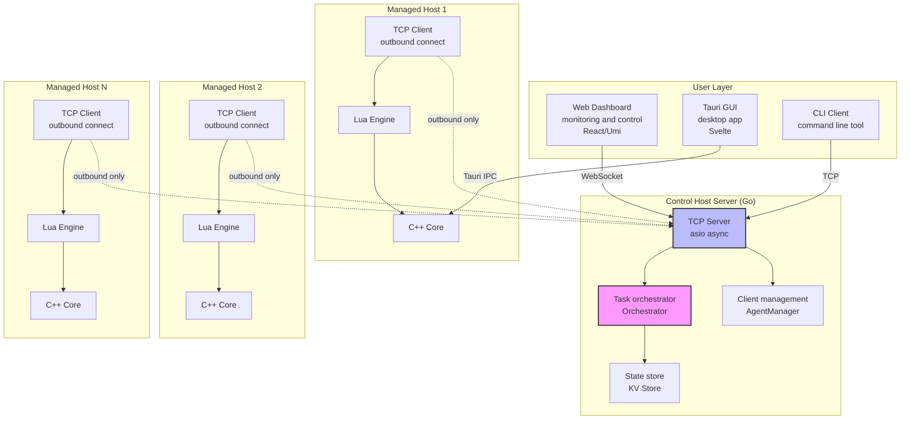
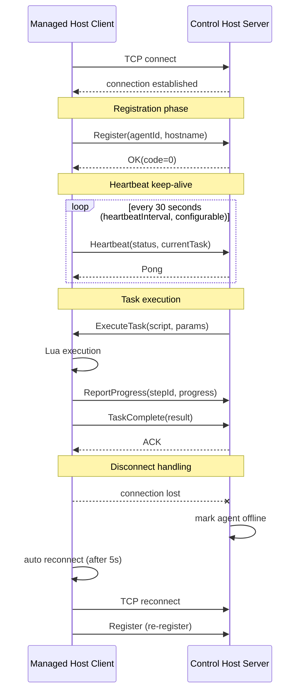
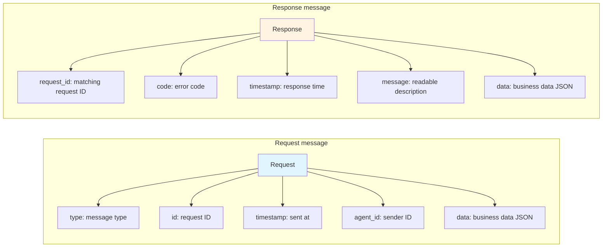
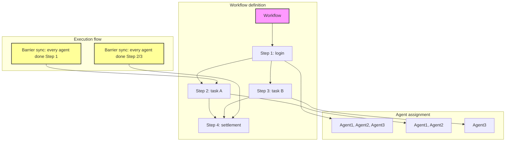
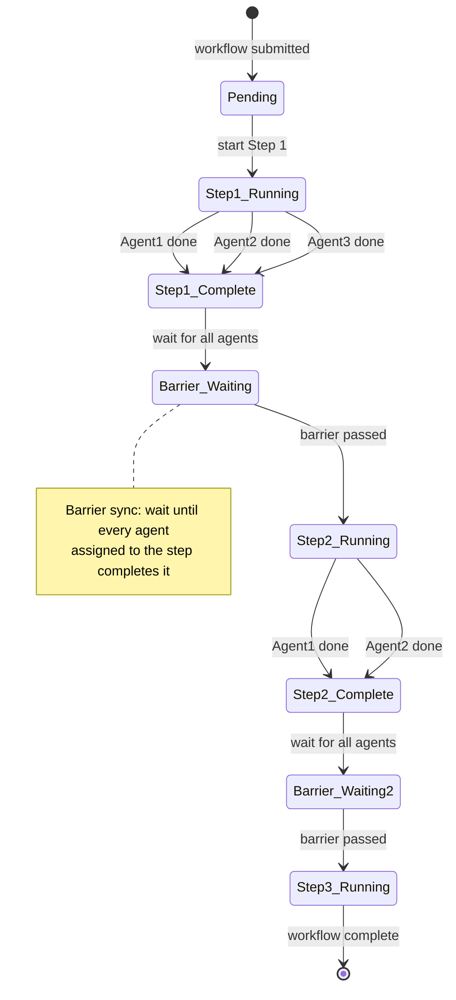
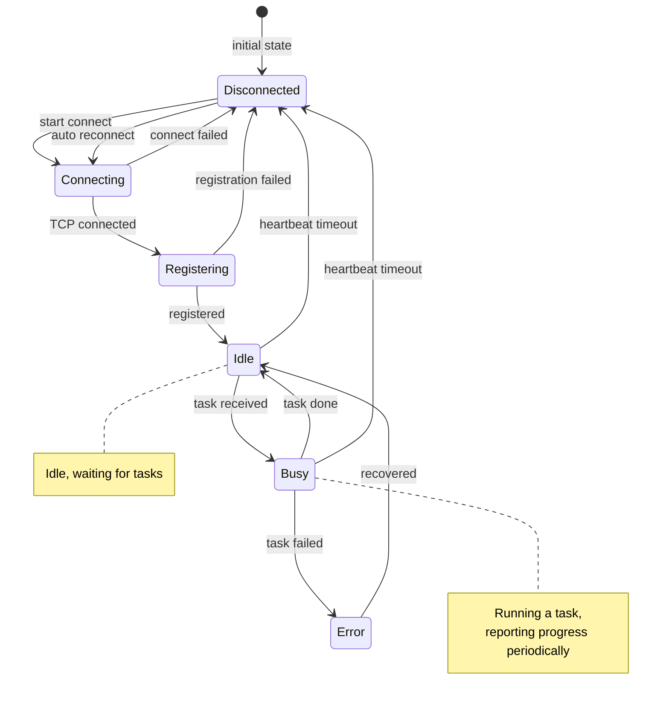

> [中文](../zh/guide/architecture.md) | **English**

# Architecture

## System Architecture Overview



## Control Host and Managed Host Architecture

### Communication Protocol



### TCP Message Format



#### Envelope Protocol

Every frame is a 4-byte binary length prefix followed by a JSON payload, with no delimiter or newline:

```
┌─────────────────────────────────────────────────────────┐
│  length prefix (4 bytes, binary)                        │
│  {"type":"heartbeat",...}          <- JSON payload      │
└─────────────────────────────────────────────────────────┘
```

- The C++ side (`libs/transport/`) writes and reads the length prefix in network byte order.
- The Go side (`orchestrator/server`) decodes the length prefix in host byte order.

#### Error Handling

The remote protocol currently has no unified numeric error-code table. Error semantics are carried by fields of the concrete message type (such as the `error` / `message` string fields; a failed token check returns `error: "invalid or missing token"`). REST endpoints between the Dashboard and the Go server use standard HTTP status codes.

## Multi-Account Collaborative Orchestration

### Workflow Model



### Barrier Synchronization



### Agent State Machine



## Core Modules

### Control Plane Modules

| Module | Responsibility | Location |
|-----|------|------|
| **Go Orchestrator** | Task orchestration, node management, workflow scheduling | `orchestrator/server/` |
| **Dashboard** | Web console and visual monitoring | `orchestrator/dashboard/` |

### Execution Plane Modules

| Module | Responsibility | File |
|-----|------|------|
| **RemoteClient** | Connects outbound to the orchestrator and exchanges tasks | `libs/agentcore/src/remote_client.cpp` |
| **Transport** | Connections, sessions and message exchange | `libs/transport/` |
| **Runtime Agent** | Local task execution and status reporting | `apps/agent/` |

### Core Capability Modules

| Module | Responsibility | File (`lib/wingman/src/`) |
|-----|------|------|
| **Screen** | Screen operations | `screen.cpp` + `platform/{win,linux,mac}/*_screen.cpp` |
| **Input** | Input simulation | `platform/win/sendinput_input.cpp`, `platform/linux/xtest_input.cpp`, `platform/mac/cgevent_input.cpp` |
| **Window** | Window management | `window.cpp` + `platform/{win,linux,mac}/*_window.cpp` |
| **Process** | Process management | `platform/win/win32_process.cpp`, `platform/{linux,mac}/posix_process.cpp` |
| **Recorder** | Macro recording | `platform/{win,linux,mac}/*_recorder.cpp` + `script/modules/macro_module.cpp` |
| **Trigger** | Trigger system | `trigger_engine.cpp`, `smart_trigger.cpp` + `platform/win/win32_trigger.cpp` |
| **Storage** | Storage system | `storage.cpp`, `kvstore.cpp` |
| **Verification** | CAPTCHA capability | `verification.cpp` |

## C++ / Lua Layering

```
┌─────────────────────────────────────────────────────────────────┐
│                    Layering decisions                           │
├─────────────────────────────────────────────────────────────────┤
│                                                                 │
│   C++ implements               Lua implements                   │
│   ──────────────               ──────────────                   │
│                                                                 │
│   ├── performance-critical ops   ├── business logic             │
│   ├── system calls               ├── state machines             │
│   ├── memory operations          ├── trigger combinations       │
│   ├── image processing           ├── user-defined behavior      │
│   └── TCP/network communication  └── script orchestration       │
│                                                                 │
└─────────────────────────────────────────────────────────────────┘
```

## Directory Structure

```
wingman/
├── .github/workflows/       # CI/CD configuration
├── apps/                    # Applications
│   ├── agent/               # C++ runtime (outbound agent)
│   │   └── src/
│   │       ├── agent.cpp            # agent main logic
│   │       ├── local_ipc_server.cpp # local IPC service (Tauri GUI control channel)
│   │       ├── standalone_mode.cpp
│   │       └── commands/            # CLI subcommands
│   ├── gui/                 # Tauri/Svelte GUI
│   │   ├── src-tauri/
│   │   └── src/
│   └── android/             # Android agent
├── lib/wingman/             # C++ core engine
├── libs/                    # Support libraries
│   ├── lua/                 # Lua bindings
│   ├── python/              # Python bindings
│   ├── transport/           # TCP transport layer (frame protocol)
│   ├── agentcore/           # remote client core (RemoteClient)
│   └── androidagent/        # Android agent library
├── orchestrator/            # Orchestration layer
│   ├── dashboard/           # web control panel (React/Umi)
│   └── server/              # Go server
├── examples/lua_scripts/    # Lua script examples
├── docs/                    # Documentation
└── scripts/                 # build and verification engineering scripts
```

Tests live next to each library (`lib/wingman/tests/`, `libs/lua/tests/`, `libs/python/tests/`); there is no top-level `tests/` directory.

## Source Layer Analysis (2026-11-07)

This section records the runtime-facing layers found by reading source code on commit `effbf56a06184f8f82e832ef47afe61f3a398f3c`. It is an abstraction of responsibilities, not a restatement of directories. Detailed vocabulary is in the [source layer glossary](./source-layer-glossary.md).

### LAY-01 Client Presentation

**Responsibility:** Turn each host shell into a local control surface and keep working UI state.

- Desktop runtime GUI is Svelte plus Tauri; the shell registers connection, scripts, configuration, screen, triggers, events, tray, macros, profiles and update commands. `apps/gui/src-tauri/src/main.rs:10`, `apps/gui/src-tauri/src/main.rs:23`.
- Browser UI state lives in stores; preferences persist to localStorage, while runtime state is refreshed from IPC. `apps/gui/src/lib/stores/settings.ts:23`, `apps/gui/src/lib/stores/connection.ts:194`, `apps/gui/src/lib/stores/events.ts:153`.
- Dashboard is Umi/React. Its startup lifecycle resolves authentication and menu state, and the browser keeps JWT plus selected game/environment scope. `orchestrator/dashboard/src/app.tsx:36`, `orchestrator/dashboard/src/pages/User/Login/index.tsx:91`, `orchestrator/dashboard/src/stores/scope.ts:45`.
- Config schema is implemented in Rust command models and TypeScript request/store models; text lives in dashboard locale files and the Svelte pages. Examples: `apps/gui/src-tauri/src/commands/config.rs:10`, `orchestrator/dashboard/src/services/wingman.ts:31`, `orchestrator/dashboard/src/locales/en-US/pages.ts:139`.
- Dedicated protocol files: local IPC uses `apps/gui/src-tauri/src/ipc/client.rs`; dashboard realtime uses `orchestrator/dashboard/src/services/websocket.ts`.

### LAY-02 Edge API And Realtime Gateway

**Responsibility:** Authenticate browser clients, expose resource APIs and fan out realtime state.

- Gin route assembly is centralized: middleware, static files, `/api/v1`, `/ws`, compatibility APIs and desktop routes all register through `RegisterRoutes`. `orchestrator/server/internal/handlers/routes.go:38`, `orchestrator/server/internal/handlers/routes.go:49`, `orchestrator/server/internal/handlers/routes.go:213`.
- Resource handlers map HTTP payloads to SQLite models and registry/relay calls. The route table names the permission per group: scripts, assets, settings, desktop, vault and recordings. `orchestrator/server/internal/handlers/routes.go:213`, `orchestrator/server/internal/handlers/routes.go:271`, `orchestrator/server/internal/handlers/routes.go:304`.
- The WebSocket hub authenticates query-token connections, tracks subscriptions and broadcasts `{type,event,data}` JSON. `orchestrator/server/pkg/websocket/hub.go:85`, `orchestrator/server/pkg/websocket/hub.go:119`, `orchestrator/server/pkg/websocket/hub.go:343`.
- The dashboard client uses a thin HTTP helper and one facade for workflow/agent/script operations. `orchestrator/dashboard/src/services/core/http.ts:44`, `orchestrator/dashboard/src/services/wingman.ts:360`.
- Configuration schema is Go environment parsing in `orchestrator/server/internal/config/config.go:76`; the dedicated protocol documents/source are `docs/protocols.md` and `orchestrator/server/pkg/websocket/hub.go`.

### LAY-03 Orchestration And Domain Control

**Responsibility:** Own durable workflow definitions, executions, templates and live agent topology.

- The workflow engine models steps, dependencies, execution records, schedules, cancellation and persistence transitions in one domain service. `orchestrator/server/internal/workflow/engine.go:39`, `orchestrator/server/internal/workflow/engine.go:54`, `orchestrator/server/internal/workflow/engine.go:395`, `orchestrator/server/internal/workflow/engine.go:1302`.
- Built-in templates produce concrete workflow payloads from reusable builders. `orchestrator/server/internal/workflow/templates.go:16`, `orchestrator/server/internal/workflow/templates.go:27`.
- The registry keeps live connection handles, status, resources, tags/capabilities, heartbeats and WebSocket change events. `orchestrator/server/internal/agent/registry.go:26`, `orchestrator/server/internal/agent/registry.go:61`, `orchestrator/server/internal/agent/registry.go:96`, `orchestrator/server/internal/agent/registry.go:171`.
- Lifecycle assembly wires SQLite, registry, frame listener, workflow engine, remote desktop and vault providers at server startup. `orchestrator/server/main.go:68`, `orchestrator/server/main.go:89`, `orchestrator/server/main.go:127`, `orchestrator/server/main.go:144`.
- State storage is SQLite/GORM for durable state; script, asset, update and recording bytes are file stores configured in `orchestrator/server/internal/config/config.go:18` and managed by `orchestrator/server/internal/assets/store.go:128`.

### LAY-04 Agent Link Layer

**Responsibility:** Preserve an outbound agent session, authenticate registration, carry commands/notifications and reconnect safely.

- Agentcore owns transport, registration/auth material, heartbeat, reconnect counters, outbox and proxy tunnel references. `libs/agentcore/src/remote_client.cpp:30`, `libs/agentcore/src/remote_client.cpp:47`, `libs/agentcore/src/remote_client.cpp:69`.
- It sends `agent.register`, `agent.heartbeat` and notify messages, and dispatches server calls to a runtime callback. `libs/agentcore/src/remote_client.cpp:372`, `libs/agentcore/src/remote_client.cpp:356`, `libs/agentcore/src/remote_client.cpp:606`, `libs/agentcore/src/remote_client.cpp:627`.
- The Go frame listener accepts runtime connections, parses the 16-byte header, routes registration/heartbeats/notify/request frames and answers with sequence-matched responses. `orchestrator/server/internal/agent/listener.go:232`, `orchestrator/server/internal/agent/listener.go:264`, `orchestrator/server/internal/agent/client.go:20`, `orchestrator/server/internal/agent/listener.go:308`.
- Reconnection uses exponential backoff with jitter and an interruptible sleep. `libs/agentcore/src/remote_client.cpp:271`, `libs/agentcore/src/remote_client.cpp:299`.
- Android reuses the same agentcore protocol through its NDK agent. `apps/android/cpp/agent/android_agent.cpp:110`, `apps/android/cpp/agent/android_agent.cpp:132`.

### LAY-05 Runtime Application And Command Facade

**Responsibility:** Start/stop one agent process, expose command semantics, bridge remote commands into local RPC and publish runtime events.

- The desktop runtime chooses embedded script, GUI mode or CLI dispatch at entry. `apps/agent/src/main.cpp:24`, `apps/agent/src/main.cpp:76`, `apps/agent/src/main.cpp:102`.
- Runtime initialization combines capability switches, remote client, standalone mode, local IPC and update polling; shutdown reverses the links. `apps/agent/src/agent.cpp:172`, `apps/agent/src/agent.cpp:191`, `apps/agent/src/agent.cpp:291`, `apps/agent/src/agent.cpp:366`, `apps/agent/src/agent.cpp:393`.
- Remote commands are rewrapped as local RPC calls, so remote and local paths reuse one dispatcher. `apps/agent/src/agent.cpp:77`, `apps/agent/src/agent.cpp:97`, `apps/agent/src/local_ipc_server.cpp:172`.
- Runtime status and script/trigger handlers are shared with local IPC; event buffering supplies the GUI pull model. `apps/agent/src/agent.cpp:297`, `apps/agent/src/agent.cpp:299`, `libs/agentcore/src/event_buffer.cpp:14`.
- Configuration schema is TOML parsing/writing in `apps/agent/src/agent_config.cpp:83` and `apps/agent/src/agent_config.cpp:229`; dedicated protocol files are the RPC dispatcher and local IPC server.

### LAY-06 Scripting Engine And API Facade

**Responsibility:** Execute user scripts through pluggable language engines and expose host capabilities as versioned module functions.

- `IScriptEngine` defines lifecycle, registration and execution; a registry/factory selects Lua or Python where built. `lib/wingman/include/wingman/script/iscript_engine.hpp:22`, `lib/wingman/include/wingman/script/script_engine_factory.hpp:20`.
- The Lua adapter binds a `wingman` table and module descriptors at engine initialization. `libs/lua/src/lua_script_engine.cpp:34`, `libs/lua/src/lua_script_engine.cpp:53`, `libs/lua/src/lua_script_engine.cpp:110`.
- `ScriptManager` owns loaded script records, worker lifecycle, output callbacks, config/env and hot reload. `lib/wingman/include/wingman/script_manager.hpp:34`, `lib/wingman/src/script_manager.cpp:242`, `lib/wingman/src/script_manager.cpp:626`, `lib/wingman/src/script_manager.cpp:833`.
- 41 module descriptors are registered in one place; their documentation pages are the user-facing text source. `lib/wingman/src/script/modules/module_registry.cpp:54`, `lib/wingman/src/script/modules/module_registry.cpp:101`, `docs/api/index.md:7`.
- Script-facing storage is SQLite by named/in-memory database plus JSON-file/optional-persistence key-value stores. `lib/wingman/src/script/modules/db_module.cpp:63`, `lib/wingman/src/script/modules/db_module.cpp:99`, `lib/wingman/src/storage.cpp:168`, `lib/wingman/src/storage.cpp:192`.

### LAY-07 Device Capability Layer

**Responsibility:** Isolate OS-specific screen, input, window, clipboard, watcher, vision and Android host behavior behind stable C++ interfaces.

- Screens/input/windows have common facades and platform backends/factories; Linux/X11, macOS/Cocoa, Windows and mock implementations are selected by backend. `lib/wingman/src/platform/input_factory.cpp:28`, `lib/wingman/src/platform/screen_backend.cpp:47`, `lib/wingman/src/platform/window_backend.cpp:281`, `lib/wingman/include/wingman/platform/iscreen.hpp:19`.
- Android access is narrowed to an injectable NDK host bridge used by screenshot/capture. `lib/wingman/src/platform/android/android_host_bridge.hpp:21`, `apps/android/cpp/agent/android_screenshot.cpp:75`, `apps/android/cpp/agent/android_screenshot.cpp:81`.
- Vision algorithms operate on captured bitmaps independently of the backend through `ImageAnalyzer`. `lib/wingman/include/wingman/vision/image_analyzer.hpp:22`, `lib/wingman/include/wingman/vision/image_analyzer.hpp:44`.
- Device-layer scripts include trigger behavior implemented per platform. `lib/wingman/src/platform/win/win32_trigger.cpp:430`, `lib/wingman/src/platform/posix/posix_trigger.cpp:415`.
- There is no separate config schema file: capability parameters are C++ structs in `lib/wingman/include/wingman/platform/*.hpp`; user-facing text is under `docs/api/` and `docs/zh/api/`.

### Layering Rationale

1. Client presentation is split from edge API because Svelte talks to local runtime capability through Tauri commands, while Umi only talks to the same-origin Go API/WebSocket and never directly to runtime. `apps/gui/src-tauri/src/main.rs:23`, `orchestrator/dashboard/src/services/core/http.ts:44`, `docs/architecture.md:31`.
2. HTTP and WebSocket are separate seams because CRUD needs request/response and permission groups, while topology/workflow/screenshot state changes need asynchronous fan-out. `orchestrator/server/internal/handlers/routes.go:213`, `orchestrator/server/pkg/websocket/hub.go:343`, `orchestrator/dashboard/src/services/websocket.ts:95`.
3. Workflow and agent topology are separate domain services: the engine owns durable steps/execution records, while registry owns volatile connection/status and push notifications. `orchestrator/server/internal/workflow/engine.go:1302`, `orchestrator/server/internal/agent/registry.go:61`.
4. The agent link is isolated so desktop and Android runtimes reuse the same reconnect/auth/heartbeat/outbox behavior instead of duplicating protocol logic. `libs/agentcore/src/remote_client.cpp:79`, `apps/android/cpp/agent/android_agent.cpp:110`.
5. Runtime application behavior is separate from link behavior because remote commands and local GUI commands must produce the same capability results through one dispatcher while lifecycle ownership remains local. `apps/agent/src/agent.cpp:77`, `apps/agent/src/agent.cpp:292`, `apps/agent/src/local_ipc_server.cpp:172`.
6. Scripting is an engine plus registered module facade so user-facing API can be documented independently of Lua/Python implementation and can be extended by descriptors. `lib/wingman/include/wingman/script/iscript_engine.hpp:22`, `lib/wingman/src/script/modules/module_registry.cpp:101`, `docs/api/index.md:7`.
7. Device access stays behind capability interfaces so platform differences and Android JNI constraints do not leak into scripting semantics. `lib/wingman/src/platform/input_factory.cpp:28`, `lib/wingman/src/platform/android/android_host_bridge.hpp:21`.
8. Storage is assigned by owner and lifetime: browser settings/session stay local, runtime scripts/DB/KV stay on-device, durable orchestration domain state uses SQLite, and binary artifacts use server file roots. `apps/gui/src/lib/stores/settings.ts:23`, `orchestrator/dashboard/src/pages/User/Login/index.tsx:97`, `orchestrator/server/internal/models/models.go:145`, `orchestrator/server/internal/assets/store.go:128`.

### Boundary Notes

- `RemoteClient` is the Android/desktop link seam; it does not own application policy. `libs/agentcore/src/remote_client.cpp:30`.
- `RpcDispatcher` is the command seam shared by local IPC and remote bridges. `lib/wingman/src/rpc/rpc_dispatcher.cpp:34`.
- `RegisterRoutes` is the HTTP authorization and route seam. `orchestrator/server/internal/handlers/routes.go:38`.
- `Store` is the server asset binary/metadata seam. `orchestrator/server/internal/assets/store.go:36`.
