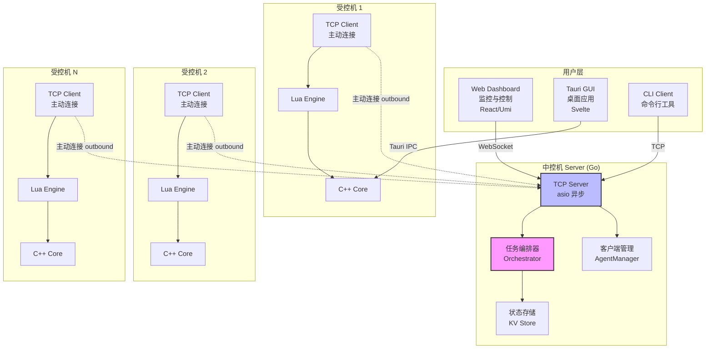
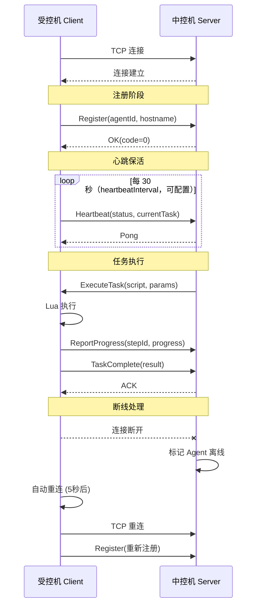
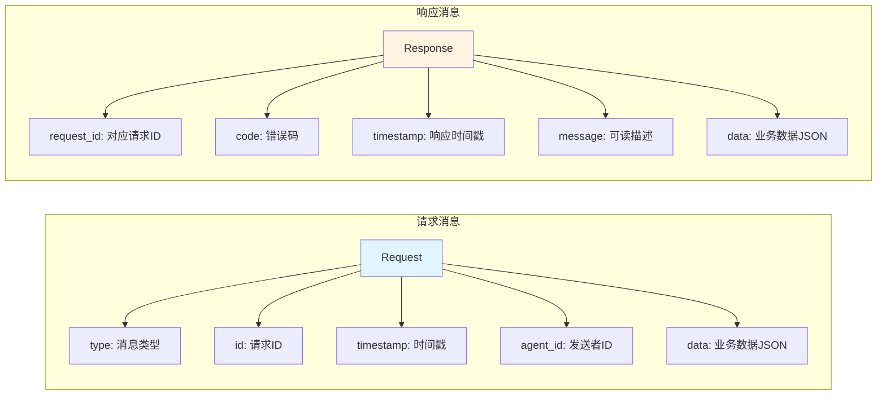
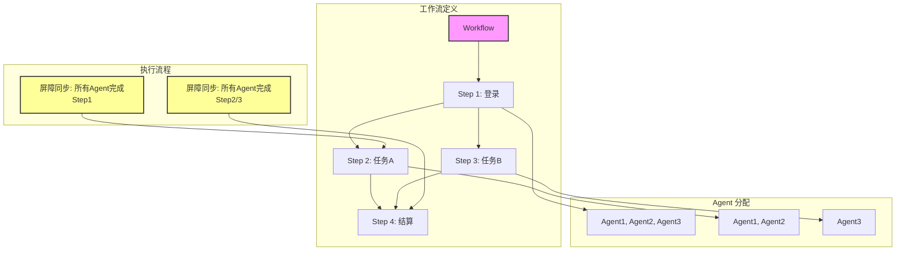
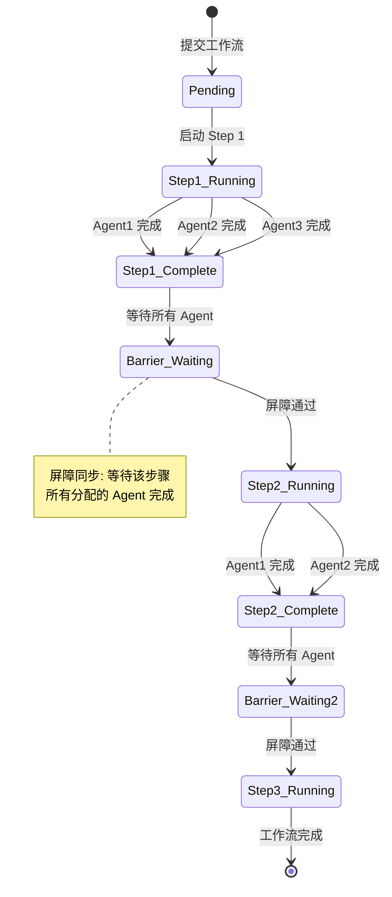
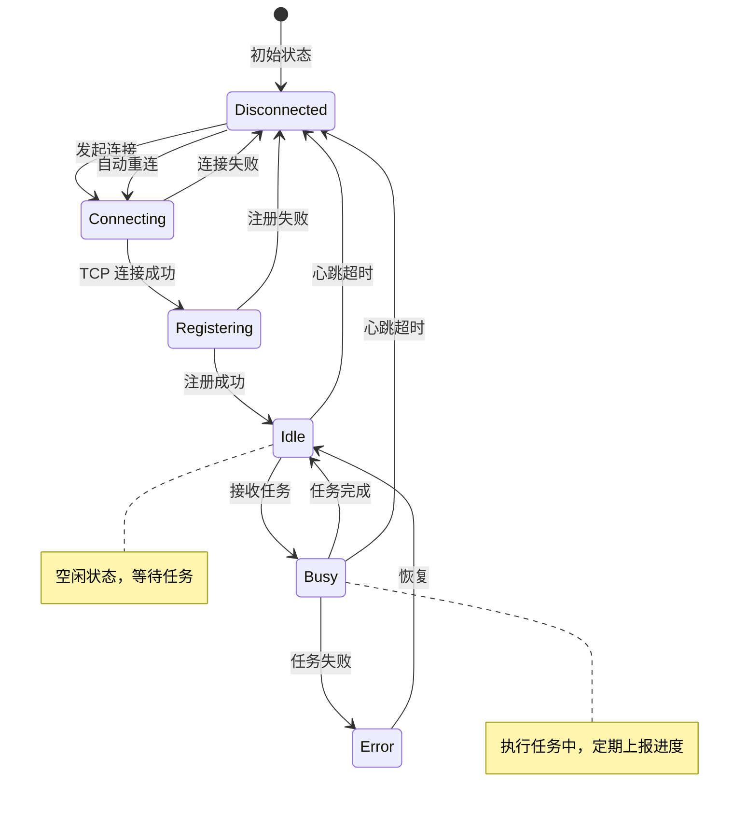

> [English](../../guide/architecture.md) | **中文**

# 架构设计

## 系统架构概览



## 中控机-受控机架构

### 通信协议



### TCP 消息格式



#### 信封协议

每帧为「4 字节二进制长度前缀 + JSON payload」，无分隔符/换行：

```
┌─────────────────────────────────────────────────────────┐
│  长度前缀（4 字节二进制）                                 │
│  {"type":"heartbeat",...}          ← JSON payload        │
└─────────────────────────────────────────────────────────┘
```

- C++ 侧（`libs/transport/`）以网络字节序写入/读取长度前缀。
- Go 侧（`orchestrator/server`）按宿主机字节序解码长度前缀。

#### 错误处理

当前远程协议没有统一的数字错误码表。错误语义由具体消息类型的字段表达（如 `error` / `message` 字符串字段，token 校验失败返回 `error: "invalid or missing token"`）；Dashboard 与 Go server 之间的 REST 接口使用标准 HTTP 状态码。

## 多账号协作编排

### 工作流模型



### 屏障同步机制



### Agent 状态机



## 核心模块

### 控制平面模块

| 模块 | 职责 | 文件 |
|-----|------|------|
| **Go Orchestrator** | 任务编排、节点管理、工作流调度 | `orchestrator/server/` |
| **Dashboard** | Web 控制台与可视化监控 | `orchestrator/dashboard/` |

### 执行平面模块

| 模块 | 职责 | 文件 |
|-----|------|------|
| **RemoteClient** | 主动连接编排器并收发任务 | `libs/agentcore/src/remote_client.cpp` |
| **Transport** | 连接、会话与消息收发 | `libs/transport/` |
| **Runtime Agent** | 本机任务执行与状态上报 | `apps/agent/` |

### 核心能力模块

| 模块 | 职责 | 文件（`lib/wingman/src/`） |
|-----|------|------|
| **Screen** | 屏幕操作 | `screen.cpp` + `platform/{win,linux,mac}/*_screen.cpp` |
| **Input** | 输入模拟 | `platform/win/sendinput_input.cpp`、`platform/linux/xtest_input.cpp`、`platform/mac/cgevent_input.cpp` |
| **Window** | 窗口管理 | `window.cpp` + `platform/{win,linux,mac}/*_window.cpp` |
| **Process** | 进程管理 | `platform/win/win32_process.cpp`、`platform/{linux,mac}/posix_process.cpp` |
| **Recorder** | 宏录制 | `platform/{win,linux,mac}/*_recorder.cpp` + `script/modules/macro_module.cpp` |
| **Trigger** | 触发器系统 | `trigger_engine.cpp`、`smart_trigger.cpp` + `platform/win/win32_trigger.cpp` |
| **Storage** | 存储系统 | `storage.cpp`、`kvstore.cpp` |
| **Verification** | 验证码能力 | `verification.cpp` |

## C++ / Lua 分层

```
┌─────────────────────────────────────────────────────────────────┐
│                    分层决策                                      │
├─────────────────────────────────────────────────────────────────┤
│                                                                  │
│   C++ 实现                    Lua 实现                         │
│   ────────                    ─────────                         │
│                                                                  │
│   ├── 性能敏感操作                ├── 业务逻辑                  │
│   ├── 系统调用                    ├── 状态机                    │
│   ├── 内存操作                    ├── 触发器组合                │
│   ├── 图像处理                    ├── 用户自定义行为            │
│   └── TCP/网络通信                └── 脚本编排                  │
│                                                                  │
└─────────────────────────────────────────────────────────────────┘
```

## 目录结构

```
wingman/
├── .github/workflows/       # CI/CD 配置
├── apps/                    # 应用程序
│   ├── agent/               # C++ 运行时（主动 Agent）
│   │   └── src/
│   │       ├── agent.cpp            # Agent 主逻辑
│   │       ├── local_ipc_server.cpp # 本地 IPC 服务（Tauri GUI 控制通道）
│   │       ├── standalone_mode.cpp
│   │       └── commands/            # CLI 子命令
│   ├── gui/                 # Tauri/Svelte GUI
│   │   ├── src-tauri/
│   │   └── src/
│   └── android/             # Android Agent
├── lib/wingman/             # C++ 核心引擎
├── libs/                    # 辅助库
│   ├── lua/                 # Lua 绑定
│   ├── python/              # Python 绑定
│   ├── transport/           # TCP 传输层（帧协议）
│   ├── agentcore/           # 远程客户端核心（RemoteClient）
│   └── androidagent/        # Android Agent 库
├── orchestrator/            # 编排层
│   ├── dashboard/           # Web 控制面板 (React/Umi)
│   └── server/              # Go 服务端
├── examples/lua_scripts/    # Lua 脚本示例
├── docs/                    # 文档
└── scripts/                 # 构建/校验工程脚本
```

测试随各库存放（`lib/wingman/tests/`、`libs/lua/tests/`、`libs/python/tests/`），无顶层 tests/ 目录。

## 源码分层分析（2026-11-07）

本节记录在提交 `effbf56a06184f8f82e832ef47afe61f3a398f3c` 上通读源码后归纳的运行时层。这里按职责抽象，不按目录复述。详细术语见[源码分层术语表](./source-layer-glossary.md)。

### LAY-01 客户端表现层

**职责：** 把不同宿主外壳变成本地控制面，并维护工作界面状态。

- 桌面 Runtime GUI 是 Svelte + Tauri；外壳注册连接、脚本、配置、屏幕、触发器、事件、托盘、宏、Profile 与更新命令。`apps/gui/src-tauri/src/main.rs:10`、`apps/gui/src-tauri/src/main.rs:23`。
- 浏览器 UI 状态在 store 中；偏好持久化到 localStorage，运行状态经 IPC 刷新。`apps/gui/src/lib/stores/settings.ts:23`、`apps/gui/src/lib/stores/connection.ts:194`、`apps/gui/src/lib/stores/events.ts:153`。
- Dashboard 是 Umi/React。启动生命周期解析登录态和菜单状态，浏览器保存 JWT 及选中的 game/env 范围。`orchestrator/dashboard/src/app.tsx:36`、`orchestrator/dashboard/src/pages/User/Login/index.tsx:91`、`orchestrator/dashboard/src/stores/scope.ts:45`。
- 配置 schema 在 Rust 命令模型和 TypeScript 请求/store 模型中；文案在 Dashboard locale 与 Svelte 页面中。示例：`apps/gui/src-tauri/src/commands/config.rs:10`、`orchestrator/dashboard/src/services/wingman.ts:31`、`orchestrator/dashboard/src/locales/en-US/pages.ts:139`。
- 专属协议文件：本地 IPC 是 `apps/gui/src-tauri/src/ipc/client.rs`；Dashboard 实时面是 `orchestrator/dashboard/src/services/websocket.ts`。

### LAY-02 边缘 API 与实时网关层

**职责：** 认证浏览器客户端，暴露资源 API，并扇出实时状态。

- Gin 路由装配收口：中间件、静态文件、`/api/v1`、`/ws`、兼容 API 和桌面路由都经 `RegisterRoutes` 注册。`orchestrator/server/internal/handlers/routes.go:38`、`orchestrator/server/internal/handlers/routes.go:49`、`orchestrator/server/internal/handlers/routes.go:213`。
- 资源 handler 把 HTTP payload 映射到 SQLite 模型和 registry/relay 调用；路由表标明各组的权限：scripts、assets、settings、desktop、vault、recordings。`orchestrator/server/internal/handlers/routes.go:213`、`orchestrator/server/internal/handlers/routes.go:271`、`orchestrator/server/internal/handlers/routes.go:304`。
- WebSocket hub 校验查询 token 连接，跟踪订阅并广播 `{type,event,data}` JSON。`orchestrator/server/pkg/websocket/hub.go:85`、`orchestrator/server/pkg/websocket/hub.go:119`、`orchestrator/server/pkg/websocket/hub.go:343`。
- Dashboard 客户端使用轻量 HTTP helper 和一个工作流/Agent/脚本操作门面。`orchestrator/dashboard/src/services/core/http.ts:44`、`orchestrator/dashboard/src/services/wingman.ts:360`。
- 配置 schema 是 `orchestrator/server/internal/config/config.go:76` 的环境解析；专属协议源是 `docs/protocols.md` 和 `orchestrator/server/pkg/websocket/hub.go`。

### LAY-03 编排与领域控制层

**职责：** 拥有持久化工作流定义、执行、模板和活跃 Agent 拓扑。

- Workflow 引擎在一个领域服务中建模步骤、依赖、执行记录、调度、取消和持久化状态迁移。`orchestrator/server/internal/workflow/engine.go:39`、`orchestrator/server/internal/workflow/engine.go:54`、`orchestrator/server/internal/workflow/engine.go:395`、`orchestrator/server/internal/workflow/engine.go:1302`。
- 内置模板通过可复用构造器生成具体工作流载荷。`orchestrator/server/internal/workflow/templates.go:16`、`orchestrator/server/internal/workflow/templates.go:27`。
- Registry 保存活跃连接句柄、状态、资源、标签/能力、心跳和 WebSocket 变更事件。`orchestrator/server/internal/agent/registry.go:26`、`orchestrator/server/internal/agent/registry.go:61`、`orchestrator/server/internal/agent/registry.go:96`、`orchestrator/server/internal/agent/registry.go:171`。
- 生命周期装配在服务启动时连接 SQLite、registry、frame listener、workflow 引擎、远程桌面与 vault provider。`orchestrator/server/main.go:68`、`orchestrator/server/main.go:89`、`orchestrator/server/main.go:127`、`orchestrator/server/main.go:144`。
- 状态存储：持久领域状态用 SQLite/GORM；脚本、资产、更新制品和录像字节用配置的文件根目录，由 `orchestrator/server/internal/assets/store.go:128` 管理。

### LAY-04 Agent 链路层

**职责：** 维持外连 Agent 会话，认证注册，承载命令/通知并安全重连。

- Agentcore 拥有传输、注册/鉴权材料、心跳、重连计数、outbox 和 proxy tunnel 引用。`libs/agentcore/src/remote_client.cpp:30`、`libs/agentcore/src/remote_client.cpp:47`、`libs/agentcore/src/remote_client.cpp:69`。
- 它发送 `agent.register`、`agent.heartbeat` 和 notify 消息，并把服务端调用派发给 Runtime 回调。`libs/agentcore/src/remote_client.cpp:372`、`libs/agentcore/src/remote_client.cpp:356`、`libs/agentcore/src/remote_client.cpp:606`、`libs/agentcore/src/remote_client.cpp:627`。
- Go frame listener 接受 Runtime 连接，解析 16 字节头，路由注册/心跳/notify/request 帧，并用 sequence 配对响应。`orchestrator/server/internal/agent/listener.go:232`、`orchestrator/server/internal/agent/listener.go:264`、`orchestrator/server/internal/agent/client.go:20`、`orchestrator/server/internal/agent/listener.go:308`。
- 重连使用指数退避加抖动，睡眠可被打断。`libs/agentcore/src/remote_client.cpp:271`、`libs/agentcore/src/remote_client.cpp:299`。
- Android 经 NDK Agent 复用同一 agentcore 协议。`apps/android/cpp/agent/android_agent.cpp:110`、`apps/android/cpp/agent/android_agent.cpp:132`。

### LAY-05 Runtime 应用与命令门面层

**职责：** 启停 Agent 进程，定义命令语义，把远程命令桥接到本地 RPC，并发布 Runtime 事件。

- 桌面 Runtime 在入口选择内嵌脚本、GUI 模式或 CLI 派发。`apps/agent/src/main.cpp:24`、`apps/agent/src/main.cpp:76`、`apps/agent/src/main.cpp:102`。
- Runtime 初始化组合能力开关、远程客户端、单机模式、本地 IPC 与更新轮询；关闭按反序收链。`apps/agent/src/agent.cpp:172`、`apps/agent/src/agent.cpp:191`、`apps/agent/src/agent.cpp:291`、`apps/agent/src/agent.cpp:366`、`apps/agent/src/agent.cpp:393`。
- 远程命令重新包装成本地 RPC 调用，因此远程与本地路径复用同一个 dispatcher。`apps/agent/src/agent.cpp:77`、`apps/agent/src/agent.cpp:97`、`apps/agent/src/local_ipc_server.cpp:172`。
- Runtime 状态与脚本/触发器 handler 共享给本地 IPC；事件缓冲向 GUI 提供拉取模型。`apps/agent/src/agent.cpp:297`、`apps/agent/src/agent.cpp:299`、`libs/agentcore/src/event_buffer.cpp:14`。
- 配置 schema 是 `apps/agent/src/agent_config.cpp:83` 和 `apps/agent/src/agent_config.cpp:229` 的 TOML 解析/写入；专属协议文件是 RPC dispatcher 与 local IPC server。

### LAY-06 脚本引擎与 API 门面层

**职责：** 通过可插拔语言引擎执行用户脚本，并把宿主能力暴露成版本化模块函数。

- `IScriptEngine` 定义生命周期、注册和执行；registry/factory 在启用构建中选择 Lua 或 Python。`lib/wingman/include/wingman/script/iscript_engine.hpp:22`、`lib/wingman/include/wingman/script/script_engine_factory.hpp:20`。
- Lua 适配器在初始化时绑定 `wingman` 表和模块描述符。`libs/lua/src/lua_script_engine.cpp:34`、`libs/lua/src/lua_script_engine.cpp:53`、`libs/lua/src/lua_script_engine.cpp:110`。
- `ScriptManager` 拥有已加载脚本记录、worker 生命周期、输出回调、config/env 与热重载。`lib/wingman/include/wingman/script_manager.hpp:34`、`lib/wingman/src/script_manager.cpp:242`、`lib/wingman/src/script_manager.cpp:626`、`lib/wingman/src/script_manager.cpp:833`。
- 41 个模块描述符集中注册；`docs/api/` 是面向用户的文案来源。`lib/wingman/src/script/modules/module_registry.cpp:54`、`lib/wingman/src/script/modules/module_registry.cpp:101`、`docs/api/index.md:7`。
- 脚本面存储是 SQLite 命名/内存数据库，以及 JSON 文件/可选持久化 KV。`lib/wingman/src/script/modules/db_module.cpp:63`、`lib/wingman/src/script/modules/db_module.cpp:99`、`lib/wingman/src/storage.cpp:168`、`lib/wingman/src/storage.cpp:192`。

### LAY-07 设备能力层

**职责：** 把 OS 相关的屏幕、输入、窗口、剪贴板、监听、视觉和 Android 宿主行为隔离在稳定 C++ 接口后。

- 屏幕/输入/窗口有共同门面和平台 backend/factory；Linux/X11、macOS/Cocoa、Windows 与 mock 由 backend 选择。`lib/wingman/src/platform/input_factory.cpp:28`、`lib/wingman/src/platform/screen_backend.cpp:47`、`lib/wingman/src/platform/window_backend.cpp:281`、`lib/wingman/include/wingman/platform/iscreen.hpp:19`。
- Android 访问收窄到可注入 NDK 宿主桥，供截屏/capture 使用。`lib/wingman/src/platform/android/android_host_bridge.hpp:21`、`apps/android/cpp/agent/android_screenshot.cpp:75`、`apps/android/cpp/agent/android_screenshot.cpp:81`。
- 视觉算法经 `ImageAnalyzer` 操作采集位图，不依赖 backend。`lib/wingman/include/wingman/vision/image_analyzer.hpp:22`、`lib/wingman/include/wingman/vision/image_analyzer.hpp:44`。
- 设备层脚本包括按平台实现的触发器行为。`lib/wingman/src/platform/win/win32_trigger.cpp:430`、`lib/wingman/src/platform/posix/posix_trigger.cpp:415`。
- 无单独配置 schema 文件：能力参数是 `lib/wingman/include/wingman/platform/*.hpp` 中的 C++ struct；文案在 `docs/api/` 与 `docs/zh/api/`。

### 拆分理由

1. 客户端表现层与边缘 API 分离，因为 Svelte 经 Tauri 命令访问本地 Runtime 能力，而 Umi 只访问同源 Go API/WebSocket，不直连 Runtime。`apps/gui/src-tauri/src/main.rs:23`、`orchestrator/dashboard/src/services/core/http.ts:44`、`docs/architecture.md:31`。
2. HTTP 与 WebSocket 是两个接缝：CRUD 需要请求/响应和权限分组，而拓扑/工作流/截图状态变化需要异步扇出。`orchestrator/server/internal/handlers/routes.go:213`、`orchestrator/server/pkg/websocket/hub.go:343`、`orchestrator/dashboard/src/services/websocket.ts:95`。
3. Workflow 与 Agent 拓扑是独立领域服务：引擎拥有持久化步骤/执行记录，registry 拥有易变连接/状态和推送。`orchestrator/server/internal/workflow/engine.go:1302`、`orchestrator/server/internal/agent/registry.go:61`。
4. Agent 链路独立出来，使桌面和 Android 复用同一重连/鉴权/心跳/outbox 行为，而不是复制协议逻辑。`libs/agentcore/src/remote_client.cpp:79`、`apps/android/cpp/agent/android_agent.cpp:110`。
5. Runtime 应用行为与链路行为分离，因为远程命令和本地 GUI 命令必须经同一 dispatcher 产生一致能力结果，而生命周期所有权仍在 Runtime。`apps/agent/src/agent.cpp:77`、`apps/agent/src/agent.cpp:292`、`apps/agent/src/local_ipc_server.cpp:172`。
6. 脚本做成引擎加注册模块门面，使用户 API 可独立于 Lua/Python 实现文档化，也可通过描述符扩展。`lib/wingman/include/wingman/script/iscript_engine.hpp:22`、`lib/wingman/src/script/modules/module_registry.cpp:101`、`docs/api/index.md:7`。
7. 设备访问保留在能力接口后，避免平台差异和 Android JNI 约束泄漏进脚本语义。`lib/wingman/src/platform/input_factory.cpp:28`、`lib/wingman/src/platform/android/android_host_bridge.hpp:21`。
8. 存储按拥有者和生命周期分配：浏览器偏好/会话留在本地，Runtime 脚本/DB/KV 留在设备，持久编排领域状态用 SQLite，二进制制品用服务端文件根。`apps/gui/src/lib/stores/settings.ts:23`、`orchestrator/dashboard/src/pages/User/Login/index.tsx:97`、`orchestrator/server/internal/models/models.go:145`、`orchestrator/server/internal/assets/store.go:128`。

### 边界说明

- `RemoteClient` 是 Android/桌面链路接缝，不拥有应用策略。`libs/agentcore/src/remote_client.cpp:30`。
- `RpcDispatcher` 是本地 IPC 与远程桥共享的命令接缝。`lib/wingman/src/rpc/rpc_dispatcher.cpp:34`。
- `RegisterRoutes` 是 HTTP 授权与路由接缝。`orchestrator/server/internal/handlers/routes.go:38`。
- `Store` 是服务端资产二进制/元数据接缝。`orchestrator/server/internal/assets/store.go:36`。
